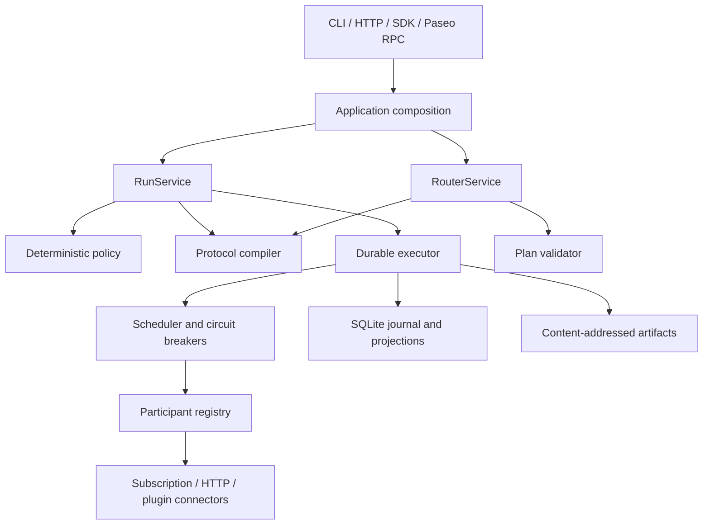

# Architecture

Switch uses a modular monolith for the local runtime. Public interfaces call
application services; they do not implement council or routing behavior.



## Dependency Direction

- `domain` and `schema` import no infrastructure.
- `protocol` compiles data and does not call participants or persistence.
- `connectors` implement `ParticipantPort` without importing runtime services.
- `runtime` orchestrates plans and ports without importing UI integrations.
- `application` is the composition root.
- `api`, `cli`, `sdk`, and `integrations` are replaceable interfaces.

`npm run boundaries` checks these rules.

## Durability

External work follows:

```text
AttemptScheduled -> InvocationStarted -> external call
  -> ArtifactRecorded -> InvocationSucceeded
```

A crash before a durable artifact leaves the attempt `unknown`. Subscription
attempts pause by default because Switch cannot prove whether the provider
completed or charged the request. A durable artifact is a recoverable receipt.

SQLite journal events and materialized state are updated in one transaction.
Artifact bytes are immutable and content-addressed.

The accepted ADRs are in [`adr/`](adr/).
